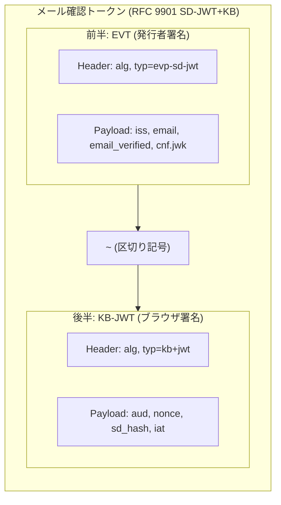

# Chrome メール認証プロトコル (Email Verification Protocol) サンプル

Google Chrome の **メール確認 (Email Verification Protocol / RFC 9901 SD-JWT+KB)** に準拠した、Java Spring Boot によるメールアドレス暗号検証サンプルアプリケーションです。

参考ドキュメント:
- [メール確認に関する更新（2026年10月） - Chrome for Developers](https://developer.chrome.com/blog/email-verification-october-2026?hl=ja&authuser=0)
- [メール確認の概要 (Identity > Email Verification)](https://developer.chrome.com/docs/identity/email-verification?authuser=0&hl=ja)
- [検証ツールガイド (Verifier Guide)](https://developer.chrome.com/docs/identity/email-verification/verifier?authuser=0&hl=ja)
- [発行者ガイド (Issuer Guide)](https://developer.chrome.com/docs/identity/email-verification/issuer?authuser=0&hl=ja)
- [RFC 9901: Selective Disclosure for JWTs (SD-JWT)](https://datatracker.ietf.org/doc/rfc9901/)

---

## 🚀 特徴と2026年10月アップデートへの対応

1. **RFC 9901 SD-JWT + Key Binding (KB-JWT) 完全対応**
   - `<Issuer-signed EVT>~<Key Binding JWT>` 形式の暗号トークンを解析・検証
   - ブラウザが動的に生成するエフェメラル公開鍵 (`cnf.jwk`) を用いた KB-JWT 署名検証と、`sd_hash` (EVTダイジェストハッシュ) の照合
2. **2026年10月更新: EVT で省略可能な `kid` (鍵ID) の候補鍵ループ検証**
   - Gmail等の発行者ではトークンヘッダーの `kid` クレームが省略されます。
   - `kid` がない場合でも、発行者の JWKS に含まれる候補公開鍵を反復ループして署名検証を自動試行します。
3. **DNS 委任検証 (`_email-verification.<domain>`)**
   - メールドメインの DNS TXT レコード (`iss=<issuer-domain>`) を検証し、発行者 URL の正当性を保証します。
4. **安全な OTP フォールバック処理**
   - Chrome未対応ブラウザ、またはユーザーが確認をスキップしてトークンが空 (`token=""`) の場合、従来のメール送信 (6桁ワンタイムパスワード) フローへシームレスに自動移行します。
5. **組み込みモック発行者 (Mock Issuer) & テストシミュレータ搭載**
   - `/.well-known/email-verification` および `/api/issuer/jwks` エンドポイントを完備
   - Chrome の Origin Trial 登録や外部 DNS 設定を行わなくても、Web UI 上のシミュレータから1クリックで動作確認・検証フローのステップ別確認が可能です。

---

## 🛠️ クイックスタート (Docker)

Docker および Docker Compose を使用して、1コマンドで環境構築と起動が可能です。

### 1. Chrome Origin Trial トークンの取得と確認

実ブラウザ（Chrome）と連携してメール自動確認をテストするには、Google の **Origin Trial トークン** が必要です。

- 🔗 **トークン取得・確認ページ**: **[Chrome Origin Trials ポータル](https://developer.chrome.com/origintrials/)**
- **対象トライアル名**: **`Email Verification`**（または `Email Verification API`）

#### トークンの取得手順
1. [Chrome Origin Trials ポータル](https://developer.chrome.com/origintrials/) にアクセスし、Google アカウントでログインします。
2. 有効なトライアル一覧から **「Email Verification」** を選択し、**「Register（登録）」** をクリックします。
3. **Web Origin** 欄にローカルテスト用オリジンを入力します：
   ```text
   http://localhost:8080
   ```
   > ※ Chrome の Origin Trials では `http://localhost:8080` のローカル開発用オリジン登録が公式にサポートされています。
4. 申請が完了すると、画面上に長い Base64 形式の **トークン文字列** が発行されます。

#### ブラウザでの適用確認手順
1. アプリケーション起動後、Chrome で [http://localhost:8080](http://localhost:8080) を開きます。
2. **F12**（または `⌘ + Option + I`）で DevTools を開きます。
3. **「Application（アプリケーション）」** タブ > 左側ツリーの **「Frames」** > **「top」** > **「Origin Trials」** を確認します。
4. `Email Verification` が **「Enabled (有効)」** と表示されていれば、トークンがブラウザに正常認識されています。

---

### 2. アプリケーションのビルドと起動

本アプリケーションは、**サーバー側から動的に Origin Trial トークンおよびセッションノンスを HTML へ注入** して配信します。

#### パターン A: Docker で起動（推奨）

##### 1. コマンドラインからトークンを指定して起動
発行されたトークンを直接渡してバックグラウンド起動します：

```bash
ORIGIN_TRIAL_TOKEN="あなたのOrigin Trialトークン" docker compose up --build -d
```

> **実行例**:
> ```bash
> ORIGIN_TRIAL_TOKEN="トークンの値をここに貼り付け" docker compose up --build -d
> ```

##### 2. `.env` ファイルに記述して起動
プロジェクト直下に `.env` ファイルを作成して起動します：

```bash
echo 'ORIGIN_TRIAL_TOKEN="あなたのトークン"' > .env
docker compose up --build -d
```

##### 3. デフォルト値で起動
トークン引数を省略した場合、[docker-compose.yml](file:///Users/pawndeveloper/workspace/email-verification-sample/docker-compose.yml) に設定されているトークンが自動適用されます：

```bash
docker compose up --build -d
```

コンテナを停止する場合:
```bash
docker compose down
```

---

#### パターン B: ローカル（Maven / Java 21）で直接起動

Docker を使わずにローカル環境で直接実行する場合：

```bash
# トークンを環境変数に設定して起動
export ORIGIN_TRIAL_TOKEN="あなたのOrigin Trialトークン"
mvn spring-boot:run
```

---

### 3. Chrome ブラウザの起動とフラグ有効化

Email Verification Protocol (EVP) を Chrome で動作確認する場合、Chrome 152+ で以下の機能フラグを有効にしてブラウザを起動します。

#### macOS の場合:
```bash
/Applications/Google\ Chrome.app/Contents/MacOS/Google\ Chrome \
  --enable-features=EmailVerificationProtocol \
  --enable-blink-features=EmailVerification \
  http://localhost:8080
```

> **備考**: Chrome Canary や Dev 版を使用する場合は、パスを `/Applications/Google\ Chrome\ Canary.app/...` に読み替えてください。

---

### 4. アクセス

ブラウザで以下のURLにアクセスします：

🔗 **[http://localhost:8080](http://localhost:8080)**

---

## 💻 画面の使い方

1. **Web UI ([http://localhost:8080](http://localhost:8080))** を開きます。
2. **クイック動作テスト (Simulator Lab)** のボタンを利用して各種シナリオをテストできます:
   - **Gmail方式 (kid省略)**: 2026年10月アップデート仕様。EVTヘッダーに `kid` が無いトークンを生成し、JWKSの全候補鍵走査により署名を検証します。
   - **標準方式 (kid指定)**: `kid` が明示されたトークンでの署名検証。
   - **フォールバック (OTP)**: トークンを空で送信し、従来の確認コード入力画面への移行をテスト。
   - **改ざんテスト**: トークン本文の一部を不正改ざんし、暗号署名不一致が正確に検知・拒否されることを確認。
3. **暗号検証インスペクター**:
   - Step 1: SD-JWT トークン解析
   - Step 2: クレーム検証 (`email_verified`, `email`, `aud`, `nonce`, `exp`)
   - Step 3: DNS 委任検証 (`_email-verification.<domain>`)
   - Step 4: 発行者メタデータ & JWKS 取得
   - Step 5: EVT 発行者署名検証、エフェメラル KB-JWT 署名検証、`sd_hash` 検証
   - 各ステップの合否と詳細ログ、デコードされたクレーム一覧がリアルタイムに表示されます。

---

## 📂 プロジェクト構成

```
email-verification-sample/
├── Dockerfile                      # Java 21 / Maven マルチステージビルド
├── docker-compose.yml              # コンテナオーケストレーション設定
├── pom.xml                         # Spring Boot 3.4, Nimbus JOSE, Bouncy Castle
└── src/
    ├── main/
    │   ├── java/com/example/emailverification/
    │   │   ├── EmailVerificationApplication.java
    │   │   ├── controller/
    │   │   │   ├── VerificationController.java     # /api/verify, /api/session-info
    │   │   │   └── MockIssuerController.java       # /.well-known/email-verification, /api/issuer/jwks
    │   │   ├── model/                              # リクエスト/レスポンス/トークンモデル
    │   │   └── service/
    │   │       ├── TokenVerificationService.java   # RFC 9901 SD-JWT+KB 統合検証エンジン
    │   │       ├── DnsResolverService.java         # _email-verification TXT レコード検証
    │   │       ├── IssuerDiscoveryService.java     # .well-known & JWKS 検出サービス
    │   │       ├── MockIssuerService.java          # テスト用 Ed25519 トークン発行サービス
    │   │       └── OtpService.java                 # トークンなし時のフォールバックOTP
    │   └── resources/
    │       ├── application.yml
    │       └── static/                             # モダンWebフロントエンド (HTML/CSS/JS)
    └── test/java/com/example/emailverification/
        └── TokenVerificationServiceTest.java       # 包括的ユニットテスト
```

---

## 🔒 フォームのHTML仕様 (Chrome Email Verification)

本サンプルで実装されているフォームの必須属性:

```html
<form action="/api/verify" method="POST">
  <!-- Chrome が認識する email 属性 -->
  <input type="email" name="email" autocomplete="email" required>

  <!-- Chrome がトークンを注入する hidden フィールド -->
  <input type="hidden" name="token"
         autocomplete="email-verification-token"
         nonce="セッションにバインドされた一意のノンス">

  <button type="submit">メールアドレスを確認する</button>
</form>
```

---

## 📜 トークン仕様 (RFC 9901 SD-JWT + Key Binding)

Chrome Email Verification Protocol でやり取りされるトークンは、**IETF RFC 9901 (Selective Disclosure for JWTs: SD-JWT)** に準拠した 2層の暗号トークン構造を持っています。

### 1. 全体構造

```text
<Issuer-signed EVT> ~ <Browser-signed KB-JWT>
```

前半の **EVT** と後半の **KB-JWT** がチルダ記号（`~`）で結合されています。



---

### 2. 前半：EVT (Email Verification Token)

メールプロバイダ（Gmail / Google Issuer）が、メールアドレスの所有権を証明するために発行・署名するトークンです。

#### ヘッダー (Header)
```json
{
  "alg": "EdDSA",
  "typ": "evp-sd-jwt",
  "kid": "key-id-optional"
}
```
> ※ 2026年10月アップデート仕様により、Gmail など一部の発行者では `kid`（鍵ID）が省略されます。検証サーバーは JWKS の候補公開鍵を反復ループして署名を照合します。

#### ペイロード (Payload)
```json
{
  "iss": "https://accounts.google.com",
  "email": "user@gmail.com",
  "email_verified": true,
  "cnf": {
    "jwk": {
      "kty": "OKP",
      "crv": "Ed25519",
      "x": "O2ONuG6VGyhhGEePz637QvC0F_8B2n... (ブラウザのエフェメラル公開鍵)"
    }
  },
  "iat": 1728638000,
  "exp": 1728638900
}
```

| クレーム | 型 | 説明 |
| :--- | :--- | :--- |
| `iss` | String | 発行者 URL（DNS TXT レコード `_email-verification.<domain>` と一致検証） |
| `email` | String | 確認されたメールアドレス |
| `email_verified` | Boolean | 必ず `true`（メールアドレスの所有確認が完了している証明） |
| `cnf.jwk` | Object | **Confirmation Claim**: ブラウザが動的生成したエフェメラル公開鍵。後半の KB-JWT を検証するために使用 |
| `iat` / `exp` | Number | 発行日時および有効期限（UNIX タイムスタンプ） |

---

### 3. 後半：KB-JWT (Key Binding JWT)

Chrome ブラウザが端末メモリ内で動的生成した**使い捨てのエフェメラル秘密鍵**を使って署名するトークンです。  
トークンの横取り・他サイトへの持ち出し・リプレイ攻撃を防ぐ「暗号学的な手錠」の役割を果たします。

#### ヘッダー (Header)
```json
{
  "alg": "EdDSA",
  "typ": "kb+jwt"
}
```

#### ペイロード (Payload)
```json
{
  "aud": "http://localhost:8080",
  "nonce": "e2033527-0bfc-4a0d-abec-561a6177301d",
  "sd_hash": "uImyA_L8V37A4N1hQWlO3G... (前半 EVT 本文の SHA-256 ハッシュ)",
  "iat": 1728638001
}
```

| クレーム | 型 | 説明・セキュリティ上の役割 |
| :--- | :--- | :--- |
| `aud` | String | **Audience（提出先オリジン）**: トークンを提出するWebサイトのオリジン。悪意ある別サイトへトークンを持ち出して流用することを防止 |
| `nonce` | String | **セッションノンス**: 検証サーバーが発行した推測不能な 128bit 以上の乱数。過去のトークンの使い回し（リプレイ攻撃）を防止 |
| `sd_hash` | String | **EVT ダイジェスト**: 前半の EVT 本文全体の SHA-256 ハッシュ値。EVT 本文の改ざんや切り貼りを防止 |
| `iat` | Number | ブラウザが署名した時刻 |

---

### 4. セキュリティ保証メカニズム

なぜサーバー側の `nonce` を使ってトークンを生成・検証するのか？

1. **チャレンジ・レスポンス方式（世界標準の設計）**
   - パスキー（WebAuthn）の `challenge` や、OpenID Connect（OAuth 2.0）の `nonce` と全く同じ原則です。
   - クライアント単独でトークンを作らせず、**「検証サーバーがその場で発行した合言葉（nonce）」** をトークン内に焼き込ませることで、攻撃者による事前計算や作り置きを排除します。
2. **使い捨て消費（Single-use / Consume-on-use）**
   - サーバーはトークンを検証すると、管理している `nonce` を即座に破棄（または消費済みにマーク）します。
   - 通信経路で盗聴されたとしても、同一トークンを再送信することはできません。
3. **エフェメラル秘密鍵による Holder Binding（所有者拘束）**
   - ブラウザのメモリ内でのみ保持される秘密鍵で KB-JWT が署名されるため、第三者が `aud` や `nonce` を勝手に書き換えて再署名することは数学的に不可能です。
